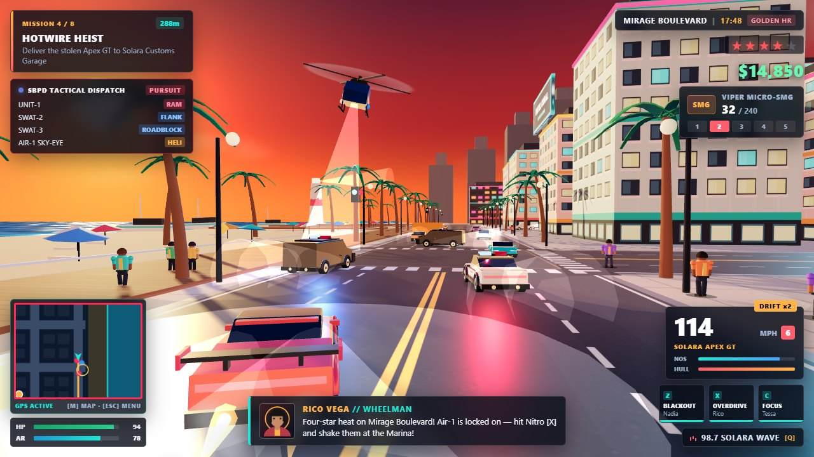
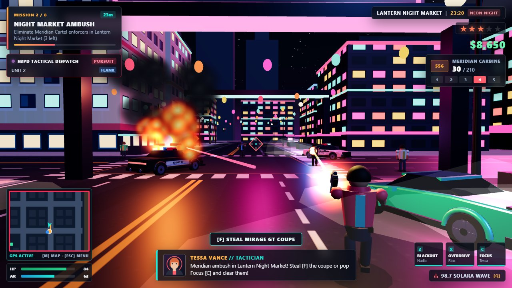
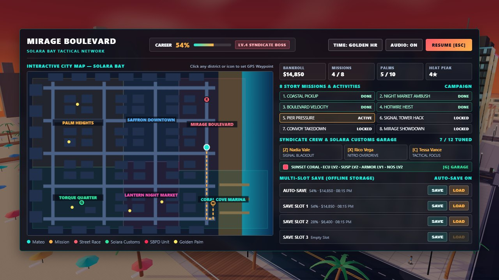
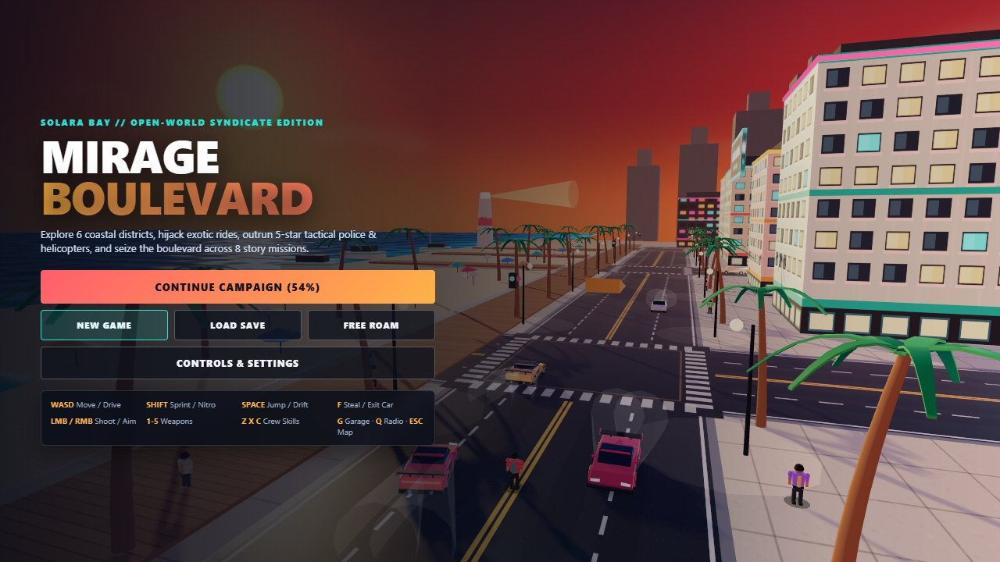

# MIRAGE BOULEVARD

[](https://make.fun/c/gta6-01)
[](https://make.fun/c/gta6-01)
[](https://make.fun/c/gta6-01)

An original, 100% offline 3D open-world coastal crime action game built for the [make.fun `gta6-01`](https://make.fun/bounty/gta6-01) bounty (`https://make.fun/bounty/gta6-01`). Runs directly in desktop Chrome from static files under `game/` with zero external network requests, sculpted `ExtrudeGeometry` vehicles, procedural Canvas2D PBR textures, custom GLSL ocean & sky shaders, and procedural Web Audio sound & multi-station radio.



## Features

- **Solara Bay — 6 Interconnected Coastal Districts**: Mirage Boulevard (pastel Art-Deco strip, golden beach, palm boardwalk & GLSL shimmering ocean), Coral Cove Marina (piers, bobbing yachts & lighthouse), Saffron Downtown (reflective skyscrapers), Lantern Night Market (neon arches, glowing overhead lanterns & food stalls), Palm Heights (Mediterranean villas), and Torque Quarter (industrial docks & Solara Customs Garage).
- **Dynamic Time-of-Day Moods**: Cycle cleanly between **Golden Hour**, **Sun-Soaked Noon**, and **Neon Night** (`T` or via Pause Dashboard) with real-time 2048px directional shadows and procedural PMREM reflections.
- **Full Open-World Gameplay**:
  - Seamless on-foot exploration & sprinting (`WASD` / `Shift` / `Space`) and vehicle hijacking/driving (`F`) across 7 original vehicle classes (`Solara Apex GT`, `Mirage GT Coupe`, `Bayside Roadster`, `Metro Linea`, `Harbor Hauler`, `SBPD Interceptor`, `SBPD Tactical SUV`).
  - Arcade-sim driving with handbrake drifting (`Space`), Nitro surge (`Shift`), suspension tilt, stunt jump ramps, progressive engine smoke/fire, and chain-reaction vehicle explosions.
  - **5-Weapon Arsenal (`1`–`5`, mouse aim & shoot)**: Coastal 9mm, Viper Micro-SMG (drive-by enabled), Breaker Combat Shotgun, Meridian Carbine, and Sunburst RPG Launcher.
  - **5-Star Wanted & SBPD Tactical Police Dispatch**: Dynamic `RAM`, `FLANK`, and `ROADBLOCK` interceptors & SWAT Tactical SUVs, on-foot officers, evasion timer, and the **SBPD Sky-Eye Police Helicopter** with a sweeping volumetric searchlight cone.
  - **8 Progressive Story Missions + Street Race + Golden Palms**: Full campaign featuring Mateo Cruz, Nadia Vale, Rico Vega, and Tessa Vance with procedural character portraits, 3D objective beacons, and Career Progression %.
  - **3 Syndicate Crew Abilities (`Z` / `X` / `C`)**: Nadia's Signal Blackout, Rico's Nitro Overdrive, and Tessa's Tactical Focus (bullet-time slow-mo).
  - **Solara Customs Garage (`G`)**: Metallic resprays, wanted heat wipe, hull repair, and 4 multi-tier performance upgrades.
  - **Interactive City Map & Multi-Slot Save System (`Esc` / `M`)**: Clickable GPS waypoint map, Career stats, and persistent `localStorage` Save Slots (`Auto-Save` + Slots 1–3).
  - **100% Offline Procedural Web Audio & 4-Station Radio (`Q` / `Tab`)**: Synthesized RPM engine, tire drift screech, sirens, weapon SFX, explosions, and 4 music/scanner stations (`98.7 SOLARA WAVE`, `104.3 NEON PULSE`, `91.5 BAYSIDE LOUNGE`, `SBPD DISPATCH CH-4`).

## Screenshots

| Neon Night Market Shootout & Carjacking | Interactive City Map, Crew & Save Dashboard | Cinematic Main Menu & Coastal Panorama |
| :---: | :---: | :---: |
|  |  |  |

## Controls

| Input | Action |
| --- | --- |
| `W A S D` / Arrows | Move on foot / Drive |
| `Shift` | Sprint / Nitro Boost |
| `Space` | Jump / Handbrake Drift |
| `F` / `E` | Enter, Hijack, or Exit Vehicle |
| `LMB` / `RMB` | Fire Weapon / Aim Zoom |
| `1`–`5` / Scroll / `R` | Select Weapon / Reload |
| `Z` / `X` / `C` | Crew Abilities (Blackout / Overdrive / Focus) |
| `G` | Enter Solara Customs Garage / Start Street Race |
| `Q` / `Tab` | Switch Radio Station |
| `V` / `T` | Cycle Camera Preset / Time of Day |
| `Esc` / `P` / `M` | Pause Menu, Interactive City Map & Save Slots |

## Play Locally & Build Dossier

Requires **Node.js 22.18+** and desktop Chrome:

```bash
# Serve the offline static game locally on http://localhost:8080
node serve.ts

# Build deterministic submission output & dossier.json
mkdir -p out && MAKEFUN_OUTPUT_DIR=out node main.ts
```

## Architecture

```text
game/
├── index.html                  # Offline entrypoint + importmap to vendored Three.js r169
├── styles.css                  # Coastal-noir HUD, minimap, Garage & City Map styling
├── vendor/three.module.min.js  # Vendored minified Three.js (zero network requests)
└── src/
    ├── main.js                 # Game loop, hotkeys, scenario presets & QA hooks
    ├── engine/                 # gameConfig.js, rendererPipeline.js, cameraInput.js
    ├── world/                  # proceduralTextures.js, roadNetwork.js, cityBuilder.js, cityProps.js
    ├── entities/               # vehicleFactory.js, vehiclePhysics.js, characterRig.js
    ├── systems/                # trafficSystem.js, combatSystem.js, policeDispatch.js, missionDirector.js, crewSystem.js, garageShop.js, vfxSystem.js, saveManager.js
    ├── audio/                  # audioEngine.js (Web Audio SFX + 4-station procedural radio)
    └── ui/                     # titleMenu.js, hudDashboard.js (Main Menu, HUD, minimap & Interactive City Map)
```

## License

MIT — see [LICENSE](LICENSE).
